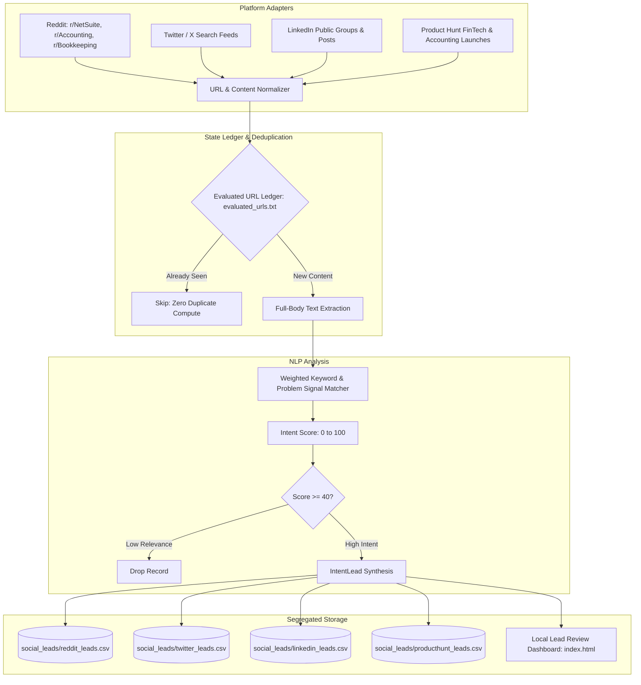

# B2B Social Intent Radar Architecture & Specification

> **Status:** Showcase & System Architecture Specification  
> **Runtime:** Python 3.12+ / GitHub Actions Serverless Daemon  
> **Storage:** Segregated Platform Flat CSV Sinks + Bloom/Set Evaluated URL Ledger

---

## 1. System Overview

**B2B Social Intent Radar** is an autonomous multi-platform crawler designed to identify high-intent enterprise buyer conversations, software migration friction, and unmet workflow demands across public professional networks without incurring paid third-party API credit costs.

---

## 2. Core Architectural Principles

### 2.1 Full-Post Context Evaluation
Unlike naive keyword scrapers that score threads solely by headline text, the Radar fetches and reconstructs the full discussion body. This filters out sarcastic comments, job postings, and bot-generated noise.

### 2.2 Weighted Problem & Migration Signal Matrix
Keywords are assigned categorical weights based on buyer stage:
- **Strong Urgent Need (Weight: 25-30):** Direct vendor dissatisfaction ("HighRadius alternative", "unapplied cash disaster", "lockbox failure").
- **Workflow Friction (Weight: 20):** Manual reconciliation pain, month-end close overtime, remittance processing bottlenecks.
- **Contextual Discovery (Weight: 10-15):** NetSuite ERP migrations, invoice billing questions.

### 2.3 Deduping State Ledger
Every visited permalink is written to an atomic append-only ledger (`evaluated_urls.txt`). On consecutive crawl cycles, seen items are discarded before body parsing, keeping bandwidth negligible and execution cycles short.

### 2.4 Autonomous 24/7 Cloud Runner
Runs serverlessly via GitHub Actions (`.github/workflows/social_radar.yml`) on a 30-minute cron cadence. Newly harvested leads are auto-committed directly to repository CSV branches with zero human intervention required.
