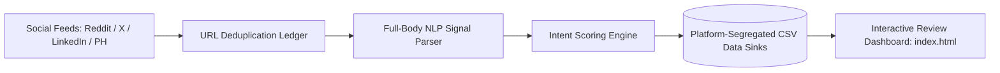

# B2B Social Intent Radar

<p align="center">
  <strong>Autonomous Multi-Platform Intent Radar & Zero-Credit Lead Engine (Python 3.12, GitHub Actions 24/7 Daemon & Real-Time Intent Scoring).</strong>
</p>

---

## Key Capabilities

- **Multi-Platform Continuous Monitoring:** Autonomously tracks Reddit (`r/NetSuite`, `r/Accounting`), Twitter/X, LinkedIn, and Product Hunt for real-time buyer pain signals.
- **Full-Body Intent Scoring:** Never qualifies on title alone. Parses post bodies against a weighted dictionary of ERP, reconciliation, and cash-flow friction signals.
- **Zero-Credit Architecture:** Queries public open endpoints and feeds without burning expensive third-party data credits.
- **Atomic Deduping Ledger:** Maintains an append-only state ledger (`evaluated_urls.txt`) to eliminate re-scraping and bound server bandwidth.
- **Serverless 24/7 GitHub Actions Daemon:** Deploys as a self-contained cron workflow (`social_radar.yml`) that auto-harvests, scores, and commits leads directly into platform-segregated CSV files.

---

## System Architecture



For the complete technical specification and scoring algorithms, see [ARCHITECTURE.md](./ARCHITECTURE.md).

---

## Data Model

Discovered opportunities are structured as clean dataclasses (`radar_schema.py`):

```python
@dataclass
class IntentLead:
    id: str
    platform: str
    url: str
    author: str
    title: str
    body_snippet: str
    matched_signals: List[str]
    intent_score: float # 0.0 to 100.0
    discovered_at: str
    company_domain: Optional[str] = None
```

---

## Directory Structure

```text
├── ARCHITECTURE.md          # Complete technical specification and scoring formulas
├── LICENSE                  # Strict Proprietary & Confidential Showcase License
├── requirements.txt         # Lightweight Python dependencies
├── radar_schema.py          # Intent lead data contracts and scan configurations
├── radar_engine.py          # Scoring engine and platform coordinator interface
├── index.html               # Real-time lead review telemetry dashboard
└── .github/workflows/
    └── social_radar.yml     # 24/7 serverless GitHub Actions cron runner
```

---

## Showcase Edition Notice

> **Note:** This repository is an architectural showcase and design portfolio piece. Proprietary anti-detection wrappers, rate-limiting bypass logic, and private social credentials are stubbed in accordance with the [LICENSE](./LICENSE). Direct execution or cloning for commercial scraping is prohibited without prior written authorization.

---

## Author & Copyright

**Created by Kartik**  
Copyright (c) 2026 Kartik. All Rights Reserved.
